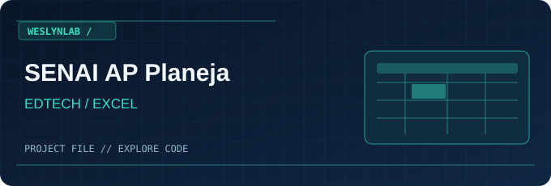
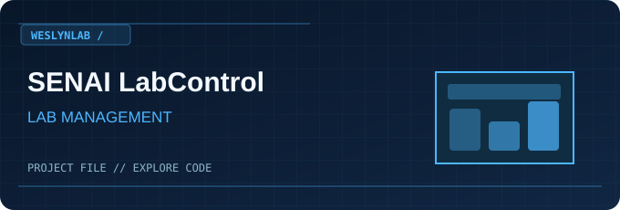
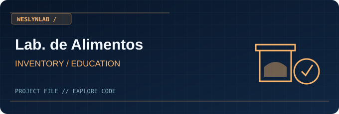
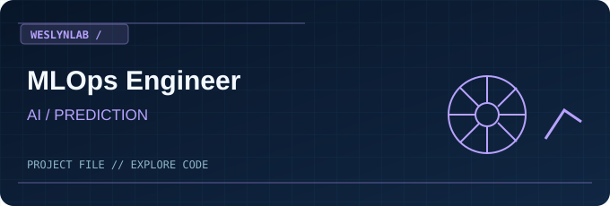
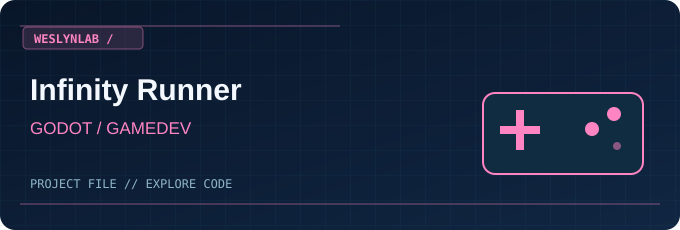
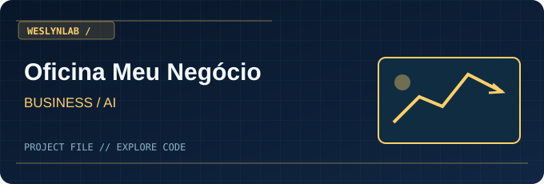

<!-- Animação de digitação SVG gerada por serviço externo; o README permanece legível mesmo sem ela. -->

---

### `01 / IDENTIDADE` — Da sala de aula ao código

Sou **Weslyn Figueiredo**, desenvolvedor de software e professor de Tecnologia da Informação. Atuo como **docente no Centro Universitário META** e **instrutor de TI no SENAI**, desenvolvendo soluções digitais e experiências de aprendizagem que conectam problemas reais, código e educação.

> **Minha missão:** transformar necessidades em ferramentas úteis e aproximar pessoas da tecnologia por meio da prática.

<table>
<tr><td align="center" width="33%"><strong>BUILD</strong> Aplicações web, sistemas e automações</td><td align="center" width="33%"><strong>TEACH</strong> Educação profissional e recursos interativos</td><td align="center" width="33%"><strong>INNOVATE</strong> IA, dados e desenvolvimento de jogos</td></tr>
</table>

### `02 / PROJETOS` — Sistemas que saem do papel

Cada projeto abaixo apresenta uma necessidade concreta e uma abordagem tecnológica. As capas são **artes conceituais criadas para a vitrine**, não capturas das interfaces.

<table>
<tr>
<td width="50%" valign="top">

 <strong>📘 SENAI AP Planeja</strong> 
Automação de planos de ensino para Excel institucional, com atenção a macros, fórmulas e estrutura.  
<a href="https://github.com/WeslynFigueiredo/senai-ap-planeja">Código e documentação ↗</a>
</td>
<td width="50%" valign="top">

 <strong>🛠️ SENAI LabControl</strong> 
Controle de ativos e inventário de laboratórios com relatórios para apoio à gestão.  
<a href="https://github.com/WeslynFigueiredo/senai-labcontrol">Código e documentação ↗</a>
</td>
</tr>
<tr>
<td width="50%" valign="top">

 <strong>🍎 Laboratório de Alimentos</strong> 
Gestão de insumos, validade e reservas para atividades práticas.  
<a href="https://github.com/WeslynFigueiredo/senai-lab-alimentos">Explorar repositório ↗</a>
</td>
<td width="50%" valign="top">

 <strong>🐟 Desafio Técnico MLOps</strong> 
Pipeline demonstrativo de predição de peso e biomassa com API, modelo e dashboard.  
<a href="https://github.com/WeslynFigueiredo/DESAFIO-TECNICO-MLOps-Engineer">Código e documentação ↗</a>
</td>
</tr>
<tr>
<td width="50%" valign="top">

 <strong>🎮 Infinity Runner — Godot</strong> 
Tutorial com vídeos e etapas para desenvolver um jogo na Godot.  
<a href="https://weslynfigueiredo.github.io/Infinity-Runner-3-ano/">Tutorial online ↗</a> · <a href="https://github.com/WeslynFigueiredo/Infinity-Runner-3-ano">Código</a>
</td>
<td width="50%" valign="top">

 <strong>💡 Oficina Meu Negócio</strong> 
Aplicação educacional para estruturar ideias de negócios com diagnóstico apoiado por IA.  
<a href="https://oficina-meu-negocio-senai.streamlit.app">Abrir aplicação ↗</a> · <a href="https://github.com/WeslynFigueiredo/oficina-meu-negocio-senai">Código</a>
</td>
</tr>
</table>

<strong>📸 Ver imagens reais e materiais dos projetos</strong>

**MLOps — Dashboard de biomassa (imagem do repositório):**

**MLOps — Predição por imagem (imagem do repositório):**

**Outros materiais didáticos:** [Pega-Pega com Godot](https://weslynfigueiredo.github.io/jogo_pega_pega_godot/) · [Infinity Runner](https://weslynfigueiredo.github.io/Infinity-Runner-3-ano/).

### `03 / STACK` — Tecnologias e competências

| Campo | Conhecimentos e ferramentas |
| :--- | :--- |
| **Desenvolvimento** | Python, PHP, JavaScript, TypeScript, C#, GDScript, HTML5, CSS3 |
| **Sistemas web** | React, Next.js, Laravel, NestJS |
| **Dados e IA** | Power BI, MySQL, PostgreSQL, Firebase/Firestore, MLOps |
| **Cloud e infraestrutura** | Docker, Azure, AWS, Google Cloud |
| **Jogos digitais** | Unity, Godot, animação 2D |
| **Redes e segurança** | Cisco, roteamento/switching, CyberOps, LGPD |

### `04 / JORNADA` — Educação e tecnologia

- 🎓 **Formação:** pós-graduação em Análise de Sistemas e Banco de Dados; graduação em Gestão de Tecnologia da Informação.
- 👨‍🏫 **Docência:** ensino superior no Centro Universitário META e formação profissional no SENAI.
- 🧪 **Aplicação prática:** ferramentas para processos acadêmicos, laboratórios, desenvolvimento de jogos e experiências educativas.
- 🔭 **Interesse contínuo:** sistemas mais eficientes, inteligência artificial aplicada e aprendizagem baseada em projetos.

### `05 / ACTIVITY LOG` — GitHub

 

---

### `CONNECT / COLLABORATE`

**Tecnologia é mais interessante quando vira solução para pessoas.**

[**WeslynLab — Portal profissional**](https://weslynlab.com.br/) · [**LinkedIn**](https://www.linkedin.com/in/weslyn-figueiredo/) · [**Repositórios**](https://github.com/WeslynFigueiredo?tab=repositories)

WESLYNLAB // BUILD • TEACH • INNOVATE

